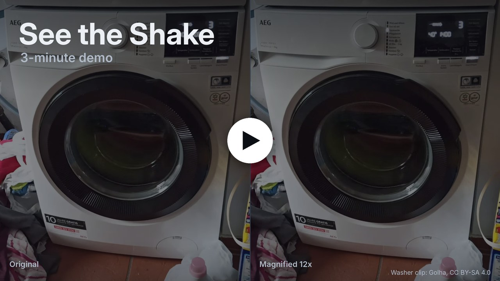
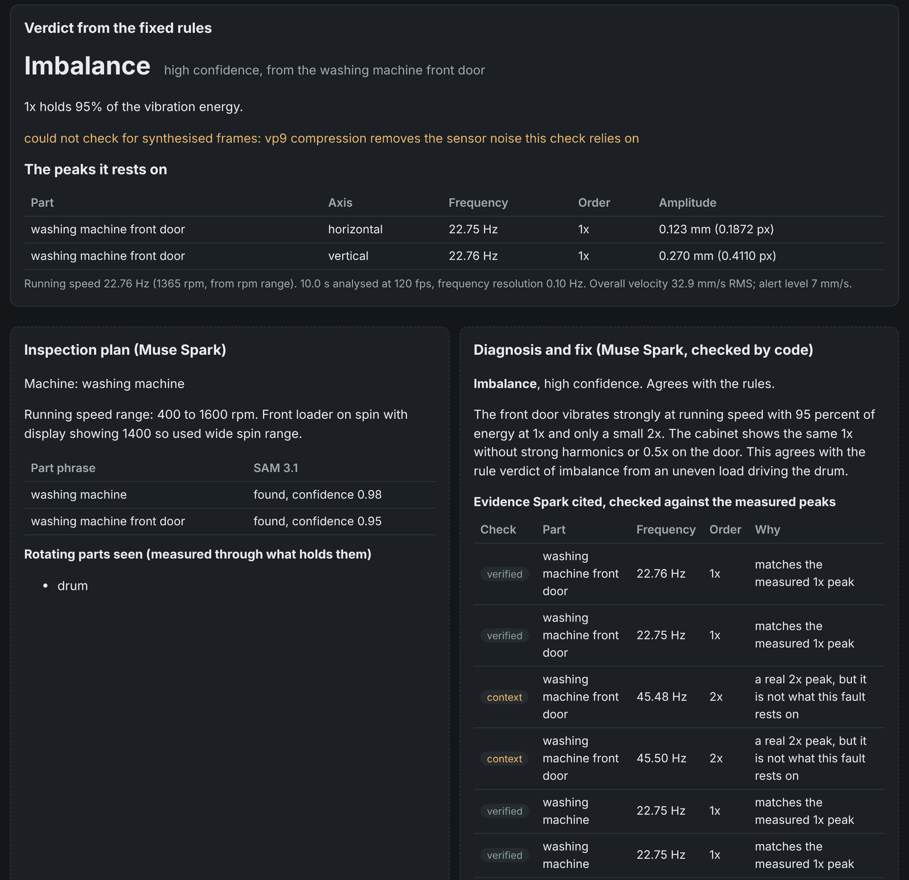

<div align="center">

# See the Shake

**Film a running machine in slow motion. See how each part vibrates, watch the shake magnified, and get the likely fault.**

[](https://youtu.be/08ZK__uc-3g)
[](https://huggingface.co/spaces/heliosbrahma/see-the-shake)
[](#meta-models)
[](#meta-models)
[](#quickstart)
[](LICENSE)

<a href="https://youtu.be/08ZK__uc-3g"></a>

<sub><a href="https://youtu.be/08ZK__uc-3g">Watch the 3-minute demo on YouTube</a> · <a href="https://huggingface.co/spaces/heliosbrahma/see-the-shake">Open the recorded runs in your browser</a></sub>

</div>

<br>

Every common machine fault leaves a vibration signature. An unbalanced rotor shakes once per revolution (1x), a
misaligned shaft shows a strong 2x, and a loose mount rattles at 0.5x with a row of harmonics. Factories read these
with accelerometers and a trained analyst. A small workshop or a home has neither, but it has a phone that films
240 fps slow motion.

See the Shake turns that clip into a diagnosis. Muse Spark plans which parts to watch and SAM 3.1 finds them. Code
measures each part's sub-pixel vibration, plays the clip back with the shake magnified so you can see it, and names
the fault from the measured peaks with fixed rules. Muse Spark then explains the fault and suggests a fix, and code
checks every claim it makes against the measurement.

Built for the Meta Global AI Developer Hackathon (Indie track). Every model call goes through the Meta Model API.

## Quickstart

You need Python 3.10 or later and ffmpeg (`brew install ffmpeg` or `apt install ffmpeg`). On Debian and Ubuntu,
`python3 -m venv` also needs `sudo apt install python3-venv`.

```bash
git clone https://github.com/iamarunbrahma/see-the-shake
cd see-the-shake
python3 -m venv .venv
source .venv/bin/activate
pip install -r requirements.txt
export MODEL_API_KEY=your-meta-model-api-key   # live runs only
uvicorn shake.web.app:app --port 8000
```

Then open http://localhost:8000.

- **No install?** The [hosted demo](https://huggingface.co/spaces/heliosbrahma/see-the-shake) opens nine recorded runs
  (the washing machine and fan twins, the real washer and the rotor rig) in your browser, with no key and no cost.
- **No key?** Open the **Digital twin** tab and pick **Recorded run, no cost**. It replays a real Muse Spark and
  SAM 3.1 run on a rendered washing machine; the first time, it renders and measures the clip, which takes a few
  minutes. The same replay from the command line: `python -m shake.pipeline --twin imbalance --api replay --seconds 6`.
- **Your own clip:** use the **Your clip** tab with Muse Spark and SAM 3.1 on, and read the
  [filming tips](#filming-tips) first.

## How it works

| | Step | Done&nbsp;by | What happens |
|:-:|---|---|---|
| 1 | Ingest | code | Reads the clip on its capture time base (phones often save 240 fps as a slowed 30 fps file), refuses clips below 120 fps, flags synthesised in-between frames and picks a steady window of up to 10 s. |
| 2 | Plan | **Muse&nbsp;Spark** | Names the machine, a running-speed range and up to four parts to measure. |
| 3 | Find&nbsp;the&nbsp;parts | **SAM&nbsp;3.1** | One stable mask per part phrase. |
| 4 | Measure | code | Tracks each part's sub-pixel motion minus the background (camera shake), leaving out light flicker, compression artifacts and spinning content such as drums and blades. One spectrum per part, with peaks labelled as orders of running speed, in mm when you give one reference length. |
| 5 | Fingerprint | code | Fixed rules give the official verdict: none, imbalance, misalignment, looseness or unclear (and high vibration at blade pass, for a fan with a known blade count), citing the peaks it rests on. |
| 6 | Magnify | code | Moves each part by alpha times its motion around 1x over an inpainted background; original and magnified play side by side. |
| 7 | Diagnose | **Muse&nbsp;Spark** | A plain-words explanation, fix steps and what to check next, with each claim checked by code. |

<p align="center">
  
  <br>
  <sub>The Nov 2 live run on a real washing machine, replayed in the app: the rule verdict, the peaks it rests on, and Muse Spark's diagnosis with
  each claim checked.</sub>
</p>

## Meta models

**Muse Spark (`muse-spark-1.3`)** has three jobs:

- **Plan.** It watches a 4 s, 480p real-time preview and returns JSON: machine type, a running-speed range (which
  only gates which peak counts as 1x) and part phrases. Code normalises the phrases and drops rotating parts such as
  blades and drums, which are measured through the housing that holds them.
- **Diagnose.** It gets the peak table, the features, the rule verdict, the spectrum image and the side-by-side
  magnified clip, and returns a fault, evidence as `[part, frequency, order]`, an explanation and fix steps. Code
  checks each evidence item against the measured peaks within one FFT bin: verified, context (a real peak that is
  not what the fault rests on) or dropped. When Spark disagrees with the rules or cites a peak that is not there,
  its confidence is capped at low and both are shown; the rule verdict stays the headline.
- **Check the video.** Spark also says which part moves most in the magnified half and in which direction. Code
  checks that against the measured motion in the magnification band (rocking is marked unverifiable, since tracking
  measures translation).

**SAM 3.1 (`sam-3.1`)** gets one streaming request per part phrase on a 60-frame sub-clip at source resolution
(uploaded once with the Files API). Vibration is sub-pixel, so one stable mask per part (a per-pixel majority over
8 decoded frames) serves the whole window. A part SAM cannot find is reported; if none are found, masks or boxes you
supplied are the fallback.

All calls use the OpenAI SDK on the Meta Model API with retries and a cost ledger. Every live run can be recorded
and replayed, so the test suite runs offline. A full run costs about 5 to 8 cents for a washing machine, and 8 to
10 cents for the fan (it has more parts to segment).

## Accuracy

| Test | Result | Details |
|---|---|---|
| Digital twin, 4 faults x 3 seeds, 1920x1080, 6 s, offline | Verdict right 12 of 12; 119 of 120 vibration components within one FFT bin and 20% amplitude | [twin accuracy](docs/accuracy/twin-accuracy.md) |
| Phone-like twin: 720p, an encoder that discards small motion | 4 of 4 verdicts; 35 of 40 components | [twin accuracy](docs/accuracy/twin-accuracy.md) |
| Live twin runs with SAM 3.1 and Muse Spark | SAM 3.1 masks at IoU 0.95 to 0.98 against the renderer's; rules right on 6 of 6, Spark agrees on all 6 | [live runs](docs/results/2026-11-02-live-twin.md), [re-scored](docs/accuracy/live-rescore.md) |
| Lab rotor rig at 500 fps, with displacement probes | 1x within 0.02 Hz of the probes on 9 of 9 runs; verdict matches the probes on 6 of 9 | [real clips](docs/results/2026-11-02-real-clips.md) |
| Real washing machine, phone clip at 120 fps | Reads imbalance | [real clips](docs/results/2026-11-02-real-clips.md) |
| Pedestal fan twin: healthy, imbalance, looseness | 3 of 3 verdicts | [live runs](docs/results/2026-11-02-live-twin.md) |

- The one twin miss is a 2x that reads 22% high. On the phone-like section, small components read low. The scored
  truth allows for the drum's slow speed drift, which spreads higher orders in any spectrum.
- The 6 of 6 live round ran on Nov 3, after the running-speed fixes. An earlier round was right on 5 of 5, with Spark
  agreeing on 4 of 5, at 108 to 197 s and $0.05 to $0.08 per run.
- On the rotor rig, the 6 of 9 are imbalance at 2000 and 3000 rpm. At 1000 rpm, where the rig sits right at the alert
  level, 2 of 3 runs show the probes' 2x pattern.
- The fan is measured through the parts that hold the blades while the blades spin. In the live runs, SAM 3.1 finds
  the guard rim and the pole but not the motor housing.

## Privacy

Your clip stays on your computer; a live run sends the Meta Model API only these pieces of it:

- for the plan, a 4 s, 480p, 30 fps preview of the steady window and one full-resolution frame (at most 1920 px wide);
- for SAM 3.1, 60 consecutive frames at full resolution;
- for the diagnosis, the side-by-side magnified clip and the spectrum image, with the measured numbers.

The three video files go up through the Files API set to expire after 7 days; the frame and the spectrum image travel
inside the requests. Recorded runs, and runs with Muse Spark and SAM 3.1 off, send nothing.

## Limits

- **A steady view.** Prop the phone up; it must not touch the machine or be handheld. Camera shake is subtracted using
  the background, so the background must be static and visible.
- **True slow motion.** At least 120 fps captured (240 fps is best). Interpolated slow-motion modes (such as 960 fps
  on many phones) invent frames; ingest flags them, and the spectrum would be meaningless.
- **Translation only.** Each part is tracked as a rigid shift in the image plane. Rocking, twisting and motion toward
  the camera are not measured, and amplitudes are fractions of a pixel, so the smallest components read low on
  compressed phone video.
- **50 Hz mains light.** The flicker handling assumes lights on 50 Hz mains, which flicker at 100 Hz (India, Europe).
  Under 60 Hz mains (the Americas, parts of Asia) it looks for flicker at the wrong frequencies, so film there in
  daylight or under flicker-free light.
- **Rules-based verdicts.** Four fault patterns plus blade pass, with thresholds tuned on the twin. Muse Spark
  explains; it does not decide. This is a hackathon prototype, not a certified condition-monitoring or safety tool,
  and it makes no ISO claims.

## Filming tips

- Film 10 s of steady running in 240 fps slow motion (720p is fine), with the phone propped on something that does not
  touch the machine, and a still background in view.
- Keep the original file: transfer by USB or a cloud drive, not a messaging app. If the phone saved the clip as a 30 fps
  file, enter the capture rate (240) when you upload.
- Give one reference length to get millimetres: the machine's width, or a height (a disc's diameter, say).
- **Fans:** the spinning blades cannot be tracked, so film from a 3/4 angle with the motor housing, guard rim and stand
  in view (for a ceiling fan, the housing and downrod) and measure those, never the blade disc. Keep curtains and paper
  out of the frame, since the fan moves them. Enter the blade count so blade pass (3x for three blades) is labelled
  and cannot push the verdict toward a fault pattern.

## Reference

<details>
<summary><b>Environment variables</b></summary>
<br>

| Variable | Default | Use |
|---|---|---|
| `MODEL_API_KEY` | none | Meta Model API key, for live runs only |
| `MODEL_API_BASE` | `https://api.meta.ai/v1` | API endpoint |
| `SHAKE_RUNS` | `./runs` | Where the web app keeps runs |
| `SHAKE_RECORDINGS` | `tests/api/fixtures/live` | Recorded live twin runs |
| `SHAKE_DEBUG` | off | `1` prints the full traceback of a command-line error |

Check the key with one small call (about a tenth of a cent):

```bash
python -m shake.api_check
```

</details>

<details>
<summary><b>Command line</b></summary>
<br>

```bash
# Your clip, with Muse Spark and SAM 3.1 (a reference length in mm gives millimetres)
python -m shake.pipeline clip.mp4 --api live --ref "washing machine=600"

# Your own masks, no model calls
python -m shake.pipeline clip.mp4 --api off --mask "door=mask.png"

# A digital twin, replaying its recorded Muse Spark and SAM 3.1 run at no cost
python -m shake.pipeline --twin imbalance --api replay --seconds 6
```

| Option | Use |
|---|---|
| `--ref "part=150:height"` | Takes the reference length as the mask's height instead of its width |
| `--capture-fps 240` | The rate the clip was filmed at, when the phone saved it as a 30 fps file |
| `--rpm`, `--rpm-range` | The running speed, if you know it, or a range for it |
| `--blades` | A fan's blade count, so blade pass is labelled |
| `--parts "phrase, phrase"` | Part phrases to use instead of Spark's |
| `--twin` | `healthy`, `imbalance`, `looseness`, `misalignment`, or `fan-healthy`, `fan-imbalance`, `fan-looseness` |
| `--seconds`, `--scale` | A twin's length (default 4 s) and resolution (default half of 1920x1080) |

Results go to `runs/<run id>/results.json`, with the videos and plots beside it. Scripts that call the pipeline need an
`if __name__ == "__main__":` guard, or SAM mask decoding falls back to serial.

</details>

<details>
<summary><b>Tests and evaluation scripts</b></summary>
<br>

The tests run offline on recorded API responses, so they need no key. They take about 13 minutes on 4 cores, or about
20 minutes the first time, which renders the small twin clips.

```bash
python -m pytest -q          # the offline suite
python -m pytest -m live     # live API tests, which cost money
```

```bash
# Regenerate the twin accuracy table
python scripts/eval_twin.py --seeds 1 2 3 --seconds 6 --phone

# Record a fresh set of live twin runs (about 25 cents) into a separate folder. It never touches the committed
# recordings in tests/api/fixtures/live/, and without --fixtures it stops before rendering anything.
python scripts/live_twin.py --fixtures out/live/recordings --out out/live --max-usd 1.0

# Replay the real clips through the current code at no cost, then compare the rotor runs with the probes
python scripts/replay_real.py --rotor-ref-height
python scripts/compare_rotor_probes.py --runs out/real_replay
```

</details>

<details>
<summary><b>Repository layout</b></summary>
<br>

| Path | Contents |
|---|---|
| `shake/` | The pipeline: `ingest`, `twin` and `twin_fan` (renderers with complete truth), `measure`, `fingerprint` (rules), `magnify`, `meta_api` (client, cost, record and replay), `plan_parts`, `segment`, `diagnose`, `pipeline`, `evaluate` (scores a twin run against its truth) and `api_check` (one small call to check the key) |
| `shake/web/` | The FastAPI app and its one page |
| `tests/` | The offline suite and the recorded API responses |
| `scripts/` | Accuracy tables and replays |
| `docs/` | The design, the plan and the results |
| `samples/real/` | The real washer clip and nine rotor-rig clips with their probe data, with their licenses |
| `reference/spike/` | The Oct 27 spike this was ported from |

</details>

## Credits

- `samples/real/aeg-washer-120fps/`: "Washing machine 120fps" by Golha, Wikimedia Commons,
  https://commons.wikimedia.org/wiki/File:Washing_machine_120fps.webm, CC BY-SA 4.0, trimmed. Anything made from
  it keeps the credit and the license, including the demo poster at the top of this page.
- `samples/real/xjtu-rotor-500fps/`: Kang, Zheng, Liu, Pei, "Vibration Displacement Dataset of Rotors under Various
  Operational Conditions: High-speed Camera Video Data and Eddy current displacement sensor data", Mendeley Data, V1,
  2024, doi:10.17632/47y7rwc2yg.1, CC BY 4.0.
- Details and changes: [samples/real/README.md](samples/real/README.md).
- The demo video's narration is an AI voice (Sarvam Bulbul), which the organizers allow for the video. The product
  itself calls only Meta models.

## License

The code is MIT licensed; see [LICENSE](LICENSE). The clips in `samples/real/` keep their own licenses, listed above.
