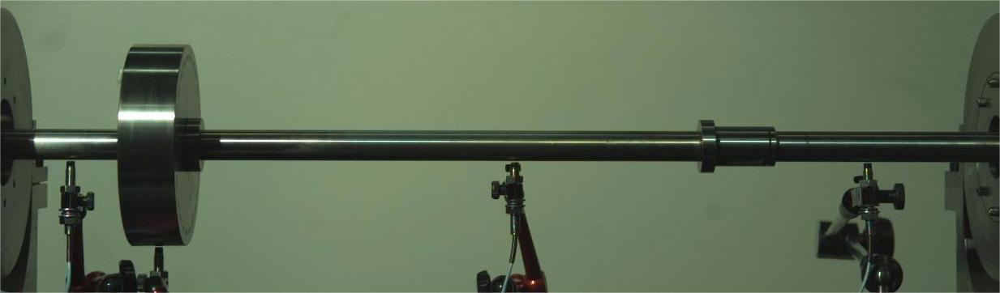
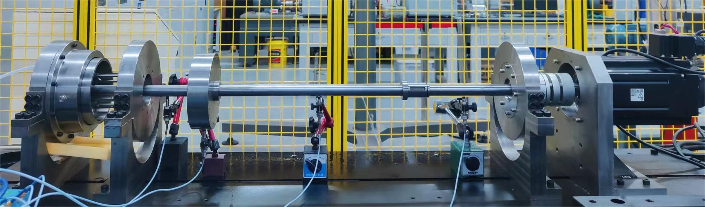

# Data Discription 
This is an explanatory document for the data set. The data was authored by `Shiyuan Pei` from  Key Laboratory of Education Ministry for Modern Design and Rotor-Bearing System, School of Mechanical Engineering, Xi'an Jiaotong University. For correspondence, please contact via email at `peishiyuan@xjtu.edu.cn`.

The experimental study involved measuring the vibration of a rotor under multiple operational conditions. The experiment was carried out on the single-disk, dual-span rotor test rig with the positioning of four sensors. Data were recorded using four eddy current displacement sensors, capturing voltage signals that correspond to displacement with a conversion factor determined by a sensitivity of 10V/mm. The sensors were set to sample at a rate of 1000 samples per second (sps). In conjunction with the sensors, a Phantom high-speed camera equipped with a Nikon optical lens was used to record the rotor during operation, with a sampling rate set to 500 frames per second (fps) and a resolution of 1280 x 800. The camera was positioned level with the height of the rotor test rig, approximately 2 meters away, and faced the rig directly for filming.

The experimental data were collected under three different unbalanced masses, with set rotational speeds of 1000, 2000, and 3000 rpm for steady-state conditions, as well as ramp-up experiments where the rotor was accelerated from rest to 3000 rpm over intervals of 4 seconds and 6 seconds, under the same three unbalanced mass conditions.

This supplementary dataset includes:
- Eddy current sensor data capturing the vibration of the rotor under various conditions.
- Original high-speed video recordings of the rotor in operation under various conditions.
- Model data of the experimental rotor rig, detailing its setup and configuration.

## Rotor Displacement Data

This repository contains a series of raw datasets from eddy current displacement sensors, capturing the behavior of a rotor under different operating conditions. The datasets represent the unprocessed, original sensor experiment data. The duration of the data capture varies and the datasets are provided in their full, untrimmed length.

### Naming Convention

- `Unb1`, `Unb2`, `Unb3`: Indicate the three different unbalance masses tested.
- `1000rpm`, `2000rpm`, `3000rpm`: Specify the constant rotational speeds at which the experiments were conducted.
- `4s`, `6s`: Denote the time intervals for the rotor to accelerate from rest to 3000 rpm.

### File Descriptions

- `4s-Unb1.csv`, `6s-Unb1.csv`: Acceleration data for Unbalance Condition 1 over 4s and 6s periods.
- `4s-Unb2.csv`, `6s-Unb2.csv`: Acceleration data for Unbalance Condition 2 over 4s and 6s periods.
- `4s-Unb3.csv`, `6s-Unb3.csv`: Acceleration data for Unbalance Condition 3 over 4s and 6s periods.
- `1000rpm-Unb1.csv`, `1000rpm-Unb2.csv`, `1000rpm-Unb3.csv`: Steady-state data at 1000 rpm for Unbalance Conditions 1, 2, and 3.
- `2000rpm-Unb1.csv`, `2000rpm-Unb2.csv`, `2000rpm-Unb3.csv`: Steady-state data at 2000 rpm for Unbalance Conditions 1, 2, and 3.
- `3000rpm-Unb1.csv`, `3000rpm-Unb2.csv`, `3000rpm-Unb3.csv`: Steady-state data at 3000 rpm for Unbalance Conditions 1, 2, and 3.

The raw video files correspond to the sensor data files, i.e. videos taken from experiments conducted under the same rotor operating conditions. The video files corresponding to the operating conditions have the same name and the extension .avi.

### Detailed File Descriptions 

Each file within this repository contains four columns of data, corresponding to the displacement measurements at four different sensor positions on the rotor. As outlined in the article, it's important to note the following specific conditions:

- During steady-state operation at 2000 rpm (`2000rpm-Unb1.csv`, `2000rpm-Unb2.csv`, `2000rpm-Unb3.csv`), the vibrations at positions \#2 and \#3 exceeded the sensor's measuring capacity. Therefore, the data from these positions at this speed should not be used for comparative testing.
  
- In the acceleration experiments (`4s-Unb1.csv`, `4s-Unb2.csv`, `4s-Unb3.csv`, `6s-Unb1.csv`, `6s-Unb2.csv`, `6s-Unb3.csv`), the rotor passes through critical speeds, resulting in significant vibrations. It is recommended to use only the data from sensor position \#4 for test comparisons in these cases. Data from other positions may also exceed the sensor's range and be truncated, which could lead to erroneous interpretations.

 For a more comprehensive understanding and instructions on the proper usage of this data, please see the relevant experimental section in the main manuscript.

### Rotor test rig
The experiment utilized a single-disk, dual-span rotor test rig designed to simulate rotor dynamics. The rig's construction mainly comprises a servo motor, a rotor shaft, a disk, two supporting bearings, and a mechanical base among other essential components. Below is an image showing the actual structure of the rotor test rig and a frame captured by the high-speed camera during the experiment. For detailed dimensions and structure, please refer to the three-dimensional model provided with the dataset. We offer the model in both STP and X_T formats for compatibility and convenience.

  
   
  <em>Frame Captured by High-Speed Camera</em>

  
   
  <em>Rotor Test Rig</em>

